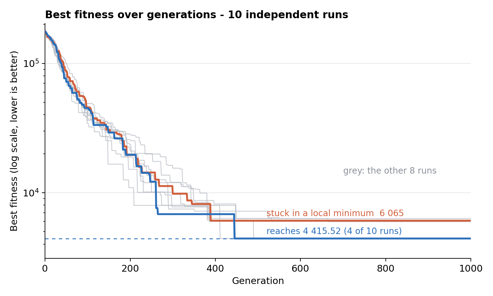

# GroupingChallenge

A genetic algorithm in C++17 that partitions points in a multidimensional space into groups, minimizing the total distance between points assigned to the same group.

Developed as a project for the *Effective Programming Techniques* course at Wrocław University of Science and Technology.

## Problem

Given *N* points in a *D*-dimensional space and a number of groups *K*, assign every point to one of the groups so that points within the same group are as close to each other as possible.

The fitness function sums the Euclidean distances between all pairs of points that share a group (each pair is counted twice); lower values are better. Problem instances are generated randomly from Gaussian distributions, so the points naturally form clusters the algorithm should discover.

## Algorithm

Each individual encodes a complete solution as a vector of length *N*, where the *i*-th gene is the group assigned to the *i*-th point.

| Component  | Implementation |
|------------|----------------|
| Initialization | uniform random group assignment for every point |
| Selection  | binary tournament (two random individuals, the fitter one wins) |
| Crossover  | one-point crossover applied with probability *p_c*; otherwise the parents are copied unchanged |
| Mutation   | each gene is reassigned to a random group with probability *p_m* |
| Stopping   | fixed number of iterations |

The evaluation code (`CGroupingEvaluator`) is independent of the optimizer: it only takes a solution vector and returns its fitness, so other optimization strategies can reuse it unchanged.

## Results

Ten independent runs on the same problem instance (100 points, 3 dimensions, 5 groups, instance seed `0`) with the default parameters. Fitness drops by more than an order of magnitude within the first 400 generations, and a single run takes about 16 seconds (Release build).



| Statistic (10 runs) | Best fitness |
|---------------------|--------------|
| Best | 4415.52 (reached in 4 of 10 runs) |
| Median | 5970.17 |
| Mean | 5416.62 |
| Worst | 6302.23 |
| Initial population (best individual) | ≈ 170 000 – 177 000 |

Four runs converge to exactly the same value, 4415.52, which is the best solution found and possibly the global optimum of this instance. The remaining six get stuck in local minima around 6000 – a typical weakness of a plain genetic algorithm with no diversity-preserving mechanism, and a natural direction for future work (elitism, niching, adaptive mutation).

## Project structure

```
.
├── CMakeLists.txt
├── docs/
│   └── fitness.png                          # convergence plot used above
└── src/
    ├── GroupingChallenge.cpp                # entry point, algorithm parameters
    ├── Optimizer.*                          # optimizer skeleton
    ├── GeneticAlgorithm.*                   # genetic algorithm implementation
    ├── Individual.*                         # individual: genotype, crossover, mutation
    ├── GroupingEvaluator.*                  # fitness function
    ├── GaussianGroupingEvaluatorFactory.*   # random problem instance generator
    └── Point.*                              # point in D-dimensional space
```

## Build and run

Requirements: CMake ≥ 3.16 and a C++17 compiler (GCC, Clang or MSVC).

```bash
cmake -S . -B build
cmake --build build --config Release
```

Run:

```bash
./build/GroupingChallenge                    # GCC / Clang
build\Release\GroupingChallenge.exe          # MSVC
```

## Configuration

Algorithm parameters are defined in `src/GroupingChallenge.cpp`:

| Parameter | Default |
|-----------|---------|
| Population size | 1000 |
| Crossover probability | 0.8 |
| Mutation probability | 0.017 |
| Number of iterations | 1000 |

The default problem instance (also in `main`) has 100 points in 3 dimensions, 5 groups, and points drawn from 5 Gaussian distributions.